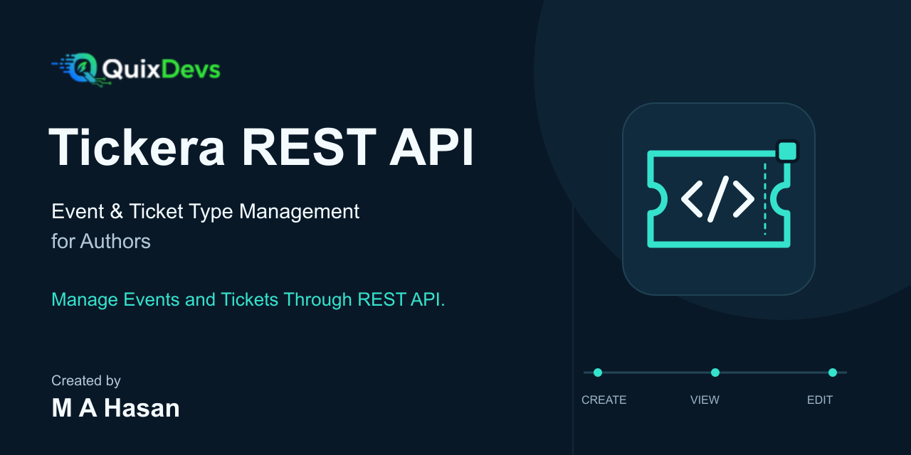

# QuixDevs Tickera REST API

**Secure REST API for Tickera Events and Ticket Types**

QuixDevs Tickera REST API is a free, open-source WordPress plugin that extends Tickera with REST API endpoints for managing events and ticket types. Authenticated WordPress users can create, retrieve, list and update authorized Tickera events and ticket types through a structured API.

Strict object-level authorization combines actual authorship with WordPress capabilities to protect against cross-author access. Ticket operations also verify ownership of the parent event. Administrators have no ownership bypass through this API.



**Version 1.0.0 · GPL-2.0-or-later · Published by QuixDevs**

## Download Latest Stable Release

**[Download quixdevs-tickera-rest-api.zip](https://github.com/hasancse06/QuixDevs-Tickera-REST-API/releases/latest/download/quixdevs-tickera-rest-api.zip)**

[View All Releases](https://github.com/hasancse06/QuixDevs-Tickera-REST-API/releases) · [v1.0.0 Release Page](https://github.com/hasancse06/QuixDevs-Tickera-REST-API/releases/tag/v1.0.0)

The lightweight release asset is the WordPress-installable package. The latest-download link becomes functional only after a stable release containing the exact **quixdevs-tickera-rest-api.zip** asset is published. The v1.0.0 page and installation asset were not publicly available at the documentation check on 2026-10-15.

GitHub's automatically generated **“Source code (zip)”** archive contains repository source and development files; it is not the recommended installation ZIP. Before publication, developers can build the installer with `python3 tools/build-release.py` and find the ZIP and SHA-256 file in `dist/`.

## Overview

Use this Tickera REST API to connect an authorized author workflow, trusted backend or WordPress web application to standalone Tickera. It provides an event management API and ticket management API for **ticket types**, rather than purchased or issued tickets.

The plugin has no WooCommerce, Stripe or payment-gateway integration. Checkout, purchasing, orders, refunds, attendees, check-in and deletion are outside scope. QuixDevs Tickera REST API is an independent extension and is not officially affiliated with Tickera.

## Key Features

- Create, list, retrieve and partially update owned events and ticket types.
- Enforce author permissions and parent-event ownership at route and write boundaries.
- Validate event dates, location, terms, existing categories and owned images.
- Support decimal-string ticket prices, finite/unlimited quantity, sale dates and owned templates.
- Allowlist request/response fields and bound collection pagination.
- Use WordPress authentication and verified Tickera save hooks.
- Fail safely when Tickera is unavailable or its persistence model is unsupported.
- Install without Composer or other bundled runtime dependencies.

## Download & Installation

1. Download **quixdevs-tickera-rest-api.zip** using the release link above. Check its adjacent SHA-256 file when available.
2. Open WordPress Admin on a site meeting the requirements below.
3. Go to **Plugins > Add New > Upload Plugin**.
4. Choose the lightweight installation ZIP.
5. Click **Install Now**.
6. Ensure standalone Tickera **3.6.0.8** is installed and activated. WordPress normally blocks addon activation while the declared Tickera dependency is inactive.
7. Activate **QuixDevs Tickera REST API**.
8. Configure WordPress REST authentication and provision the selected API user's Tickera capabilities.
9. Test access to an event owned by that user, as shown under Getting Started.

If Tickera later becomes inactive or missing, the addon loads safely, shows an administrator notice and returns 503 for authenticated management requests. There is no addon settings page or shared API key to configure. The **QuixDevs REST API** information screen appears under Tickera, with a Tools fallback during onboarding.

See [installation](docs/installation.md) and [configuration](docs/configuration.md) for details.

## Requirements

| Component | Declared requirement | Locally executed versions |
|---|---|---|
| WordPress | 6.8+ | 6.8 and 7.1.3 |
| PHP | 8.1+ | 8.2.4 and 8.4.13 |
| Tickera | Standalone 3.6.0.8, installed and active | 3.6.0.8 |
| Database | MySQL/MariaDB with connection advisory locks | MariaDB 10.4.28 |
| Transport | HTTPS for external integrations and production writes | Local HTTP authentication; HTTPS enforcement in integration tests |

PHP 8.1/8.3 and MySQL 8.0 are configured CI targets, not locally executed compatibility results. Production TLS/proxy behavior and multisite are unverified. See [compatibility](docs/compatibility.md) and the [verification results](docs/verification-results.json).

## Getting Started

1. Set the WordPress site timezone; event and sale dates use that timezone.
2. Grant the intended account the minimum Tickera creation/editing capabilities in the [authentication guide](docs/authentication.md). The addon grants no permissions automatically.
3. Create a separate WordPress Application Password for that user, or use an authenticated WordPress session with a REST nonce.
4. Set the API base URL to `https://YOUR-SITE/wp-json/quixdevs-tickera/v1` and call `GET /events`.
5. Use a returned event ID with `GET /events/{id}` to verify ownership access. An empty list is valid; create a draft event if the user owns none.

Creation requires the relevant Tickera creation capability. Reading/editing requires the registered editing capabilities; publishing and private records require additional grants. Dashboard access is separate from API access.

## REST API Endpoints

Base path: `/wp-json/quixdevs-tickera/v1`. All operations require authentication and the ownership/capability rules below.

| Method | Endpoint | Purpose | Authentication |
|---|---|---|---|
| GET | `/events` | List own editable events | Required |
| POST | `/events` | Create an event as the current user | Required |
| GET | `/events/{id}` | Retrieve an owned event | Required |
| PATCH | `/events/{id}` | Partially update an owned event | Required |
| GET | `/events/{id}/tickets` | List own ticket types under an owned event | Required |
| POST | `/events/{id}/tickets` | Create a ticket type under an owned event | Required |
| GET | `/tickets/{id}` | Retrieve an owned ticket type and verify its parent | Required |
| PATCH | `/tickets/{id}` | Partially update an owned ticket type | Required |

Reads and PATCH return 200; creation returns 201. See the [complete REST API contract](docs/rest-api.md) for field types, request/response examples, pagination and errors. No DELETE operation exists.

## Authentication

External applications use **WordPress Application Passwords over HTTPS**, with the intended user's WordPress username and user-specific password through HTTP Basic authentication. The credential inherits that user's permissions. Revoke it when the integration is retired.

A WordPress-hosted browser application can use the logged-in user's cookie plus the `X-WP-Nonce` header containing a `wp_rest` nonce. A nonce alone does not authenticate a user. Never embed Application Passwords in public JavaScript, mobile binaries or repository files. See [authentication and secure provisioning](docs/authentication.md).

## Authorization & Ownership Rules

- Events must belong to the authenticated user through their actual `post_author`.
- Tickets must belong to that user and reference a valid, editable event owned by the same user.
- New resources are attributed to the authenticated creator; clients cannot choose another author.
- Ticket creation requires an authorized parent. Its association cannot be changed with PATCH.
- Forged `author_id`, `post_author`, arbitrary metadata and unknown fields are rejected.
- Registered WordPress capabilities apply alongside ownership, including publication permissions.
- These ownership rules also apply to administrators using this API.

Anonymous requests return 401. Foreign, nonexistent or invalid-parent objects return a generic 404; an owned object lacking editing permission returns 403. Invalid schemas/body fields return 400, while inconsistent date ranges can return 422. See [authorization](docs/authorization.md) for the two-author matrix. Native WordPress/Tickera routes and dashboard permissions retain their own policies.

## API Request Examples

Use fake placeholders below with your own HTTPS site, selected author and owned IDs. Provision `WP_APP_PASSWORD` securely in your environment; do not paste real credentials into shared shell history. On shared machines use a protected credential helper as explained in the [curl guide](docs/examples/curl.md).

```sh
API_BASE='https://wordpress.example/wp-json/quixdevs-tickera/v1'
WP_API_USER='YOUR_AUTHOR_LOGIN'
# WP_APP_PASSWORD must contain that user's Application Password.

# List own events.
curl --fail-with-body --user "$WP_API_USER:$WP_APP_PASSWORD" \
  "$API_BASE/events?page=1&per_page=20"

# Create a draft event; retain its returned id.
curl --fail-with-body --user "$WP_API_USER:$WP_APP_PASSWORD" \
  --header 'Content-Type: application/json' --request POST \
  --data '{"title":"Community conference","start_at":"2027-01-14T09:00","end_at":"2027-01-14T18:00","location":"Dhaka"}' \
  "$API_BASE/events"

# Replace 123 with an event ID owned by this user.
EVENT_ID=123
curl --fail-with-body --user "$WP_API_USER:$WP_APP_PASSWORD" \
  "$API_BASE/events/$EVENT_ID/tickets"

# Replace 456 with an owned ticket type under an owned event.
TICKET_ID=456
curl --fail-with-body --user "$WP_API_USER:$WP_APP_PASSWORD" \
  --header 'Content-Type: application/json' --request PATCH \
  --data '{"price":"60.00","quantity":120}' \
  "$API_BASE/tickets/$TICKET_ID"
```

Send prices as decimal **strings**, quantities as integers or null, and dates as site-local `YYYY-MM-DDTHH:MM`. Quantity null means unlimited; zero means zero available. PATCH accepts only supplied writable fields, not an entire response object.

[Complete curl, JavaScript and PHP examples](docs/examples.md) · [Importable Postman collection](docs/postman/quixdevs-tickera-rest-api.postman_collection.json)

## Tickera Compatibility

The verified model is standalone **Tickera 3.6.0.8**, dependency slug `tickera-event-ticketing-system`. Other Tickera versions fail closed with 503 until verified. The plugin uses actual `tc_events` and `tc_tickets` records and preserves Tickera's save lifecycle.

WooCommerce is unnecessary. WooCommerce Bridge ticket products are unsupported: detected Bridge/custom relationship mode returns 409 for ticket operations; event operations remain available. Premium Bridge compatibility has not been tested. This API adds no checkout, gateway, purchasing, refund or check-in functionality. See [Tickera integration findings](docs/tickera-integration.md).

## Security

Requests use explicit schemas and field allowlists, stored content is sanitized, private metadata is omitted and responses use private/no-store cache headers. Collections constrain ownership and editable statuses on the server. Configure upstream caches to honor those headers and render returned content safely.

Related addon writes use nonblocking database locks. A conflict/unavailable lock returns `quixdevs_resource_busy` with 409; retrieve current state before retrying. Native admin screens and other plugins do not share these locks. WordPress post/meta hooks are not transactional: a late failure can partially persist, and blind POST retries can create duplicates. See [security and operational limits](docs/security.md).

## Documentation

- [Installation](docs/installation.md) and [configuration](docs/configuration.md)
- [Full REST API reference](docs/rest-api.md)
- [Authentication](docs/authentication.md) and [authorization](docs/authorization.md)
- [curl, JavaScript and PHP examples](docs/examples.md)
- [Compatibility](docs/compatibility.md) and [Tickera data model](docs/tickera-integration.md)
- [Testing](docs/testing.md) and [recorded verification results](docs/verification-results.json)
- [Release distribution and manual publication](docs/release-distribution.md)
- [v1.0.0 release notes](docs/github-release-notes.md)

## Testing & Quality Assurance

The recorded local integration matrix covers WordPress **6.8/7.1.3** with PHP **8.2.4/8.4.13** and genuine Tickera **3.6.0.8**. Each combination passed **56 tests and 433 assertions**. Additional verification passed **14 real HTTP authentication/API checks** and **17 packaging/draft-helper tests**. Recorded WPCS, PHPStan, official Plugin Check, workflow linting and secret scans passed; see [verification evidence and limits](docs/release-readiness-report.md).

These are local preparation results. The configured PHP 8.1/8.2/8.3/8.4 GitHub Actions matrix has not been represented as an executed remote run. Test-bootstrap suppression of upstream Tickera deprecations and other limits are documented in [testing.md](docs/testing.md).

```sh
composer install
composer lint
composer analyse
composer test:release
# Requires an isolated installed WordPress/Tickera fixture; never use production.
QUIXDEVS_WP_PATH=/path/to/isolated-wordpress composer test
python3 tools/build-release.py
```

## Changelog

**1.0.0** introduces the eight author-scoped event/ticket-type operations, verified standalone Tickera persistence, input validation, ownership enforcement, related-write locks and lightweight release tooling. See [CHANGELOG.md](CHANGELOG.md).

## Contributing

Review the API contract and ownership policy before proposing changes. Describe the concrete problem, affected WordPress/PHP/Tickera versions and a reproducible example using synthetic data. Include relevant tests, run the documented quality checks and keep changes within the event/ticket-type management scope.

Do not include passwords, tokens, private event data or attendee information in issues or pull requests. Report suspected security issues privately through [QuixDevs](https://quixdevs.com/) as described in the security guide. Maintainers review drafts and publish releases manually; no contribution should bypass ownership checks.

## License

**GPL-2.0-or-later**. See [LICENSE](LICENSE) and the [third-party licensing/attribution audit](docs/licensing.md). Tickera and WordPress are separate required installations and are not bundled in the lightweight ZIP.

## Developer & Maintainer

Developed by **Md Abu Hasan**. [Portfolio](https://hasan.online/) · [GitHub](https://github.com/hasancse06)

Publisher and maintainer: **QuixDevs**. [Website](https://quixdevs.com/)

QuixDevs Tickera REST API is an independent extension and is not officially affiliated with Tickera.
